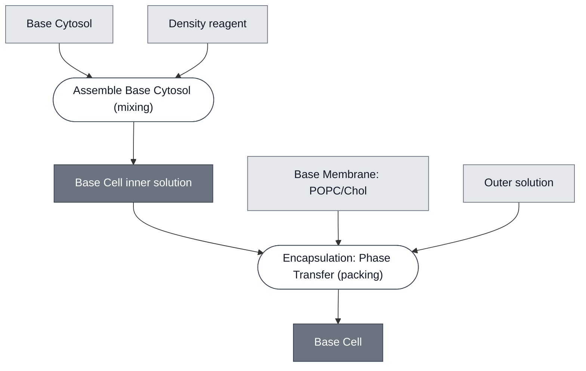

# Overview

The Base Cell is [Base Cytosol](../base-cytosol/spec.md) encapsulated in [Base Membrane](../membrane-popc-chol/spec.md) via [Encapsulation: Phase Transfer](../../processes/assemble-base-cell/main.md). The Base Cell is deployed in a glucose outer solution and represents the default synthetic cell for the Nucleus distribution. Base Cells have red fluorescent membranes (Liss-Rhod PE). With `pOpen-deGFP` as their template DNA, they express GFP over time if functioning correctly.

:::{figure} schematic.png
:width: 100%
:align: center

Overview of Base Cell, composed of [Base Cytosol](/docs/modules/base-cytosol/spec.md) encapsulated with [Base Membrane](/docs/modules/membrane-popc-chol/spec.md). Constitutive components of each module schematically depicted.
:::

# Reference Composition

:::::{tab-set}

<!-- gen:composition-diagram -->
::::{tab-item} Module Dependencies

::::
<!-- /gen:composition-diagram -->

::::{tab-item} Cytosol

The inner solution encapsulated into the Base Cell is [Base Cytosol](/docs/modules/base-cytosol/spec.md) at reaction concentration, with Optiprep for phase transfer. Template DNA is optional; the cell was validated with `pOpen-deGFP` DNA as a reporter.

:::{table}
:label: comp-cytosol

| Component         | Input concentration | Final concentration | Volume for one reaction (µL) |
| ----------------- | ------------------- | ------------------- | ---------------------------- |
| SMix              | 3.33x               | 1x                  | 12                           |
| PMix              | 15 mg/mL            | 1.80 mg/mL          | 4.8                          |
| Ribosomes         | 10 µM               | 1.8 µM              | 7.2                          |
| tRNA              | 35 mg/mL            | 3.5 mg/ml           | 4                            |
| RNase Inhibitor   | 40 000 U/mL         | 2000 U/mL           | 2                            |
| Optiprep          | 1.32 mg/µL          | 0.043 mg/µL         | 1.33                         |
| Template DNA (optional), e.g. `pOpen-deGFP` | 124 nM | 3 nM     | X, e.g. 0.95                 |
| Water             |                     |                     | 8.67 − X                     |
| Total volume (µL) |                     |                     | 40                           |
:::

::::

::::{tab-item} Membrane

:::{table}

| Component    | Target (mmol/mol)     | Molecular Weight (g/mol) | Stock concentration (mg/mL) | Volume to add (µL) |
| ------------ | --------------------- | ------------------------ | --------------------------- | ------------------ |
| POPC         | 699.3                 | 760.076                  | 25                          | 162.01             |
| Cholesterol  | 299.7                 | 386.654                  | 50                          | 17.66              |
| Liss-Rhod PE | 1                     | 1301.71                  | 1                           | 9.92               |

:::

See [Base Membrane](../membrane-popc-chol/spec.md) for the full membrane spec.

::::

::::{tab-item} Outer Solution

:::{table}

| Component | Concentration |
| --------- | ------------- |
| Glucose   | 1140 mM, a starting recipe: adjust it until its osmotic concentration is 100 mOsm/kg to 150 mOsm/kg below the inner solution's |
:::

::::

:::::

# Expected Behavior

With `pOpen-deGFP` as their template DNA, Base Cells express deGFP over time, starting dark and increasing in green fluorescence as translation proceeds. Kinetics data are reported in [DevNote bnext-devnotes-base-cell-01](https://devnotes.nucleus.engineering/articles/bnext-devnotes-base-cell-01).

:::{figure} cell-image.png
:width: 100%
:align: center

Combined green (488 nm) and red (561 nm) fluorescence channels. First time point (labeled "t = 0") corresponds to 30 min after preparation of the inner solution, reflecting the time required to prepare liposomes.
:::

# Process

[Build a Base Cell](../../processes/build-base-cell/main.md) gives every step at the bench, in order, as one protocol. Base Cells are assembled and encapsulated using [Encapsulation: Phase Transfer](../../processes/assemble-base-cell/main.md).

# Constituent Modules

- [Base Cytosol](../base-cytosol/spec.md) — inner solution, encapsulated at reaction concentration
- [Base Membrane](../membrane-popc-chol/spec.md) — 70:30 POPC:cholesterol bilayer

# Credits

Developed by Surendra Yadav (b.next).

# Supported by

DevNotes that reference this spec, not curated attribution; see Credits for that.

::::{grid} 1 1 1 1
:class: devnote-cards

:::{card} DevCells: Kickoff Workshop
:link: https://devnotes.nucleus.engineering/articles/019c3f08-25a7-752c-8821-cd4634bde800
:footer: DevCells Kickoff Workshop · Developer Cells

:::

:::{card} Double emulsion optimization: inner solution, lipid concentration, and composition
:link: https://devnotes.nucleus.engineering/articles/019d64b1-f6b1-7d50-ba0d-7419f01c0141
:footer: Mary Kelly · Node: Chicago

:::

:::{card} IV-HSL Emitter Cell
:link: https://devnotes.nucleus.engineering/articles/01945265-b728-7938-aab0-1ce134f4dffa
:footer: Yen-Yu Hsu · Nucleus Core

:::

:::{card} Liposome encapsulation: A tractable and reproducible approach
:link: https://devnotes.nucleus.engineering/articles/019f7d5b-f635-7e77-b7fc-c2e7d8d09f8a
:footer: Chris Falcon, Katie Drew · Workshops and Courses

:::

:::{card} Nucleus Base Cell Testing
:link: https://devnotes.nucleus.engineering/articles/019b13f9-1ec6-757c-b5ed-68cdd8e91fb0
:footer: Surendra Yadav · Nucleus Core

:::

:::{card} Understanding Liposome Behaviour in Hydrogel Matrices
:link: https://devnotes.nucleus.engineering/articles/01a10dfe-c1df-7c2d-ba5a-035280a349f7
:footer: Ojaswita Pant, Manuel Bibrowski · DevStudio 2026

:::

::::
