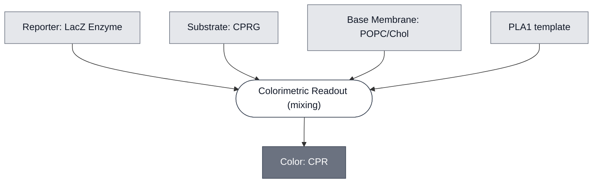

:::{attention} 🚧 Draft
This page is a work in progress and not yet ready for use.
:::

# Overview

Reporter: Color Change outputs a visible color change in response to a signal. As designed, Phospholipase A1 (PLA1) is expressed in the presence of a signal, which then lyses a membrane holding chlorophenol red-β-D-galactopyranoside (CPRG, yellow), which is then catalyzed by β-galactosidase (LacZ) and converted to chlorophenol red (CPR, purple). Where each component is localized (e.g., "one vessicle" has dye OR enzyme in the synthetic cell and the other component in outer solution, "two vessicle" has dye in one liposome and enzyme in another") depends on the implementation. See the [pH Cascade](../ph-cascade/spec.md), with PLA1 expressed in a [pH Sensing Cell](../ph-sensing-cell/spec.md), CPRG in separate liposomes, and the enzyme in the outer solution, for a concrete implementation.

# Reference Composition

:::::{tab-set}

<!-- gen:composition-diagram -->
::::{tab-item} Module Dependencies

::::
<!-- /gen:composition-diagram -->

::::{tab-item} Substrate

:::{table} Where the substrate is held until lysis.
:label: comp-color-change-substrate

| Substrate | Held in | Module |
| --- | --- | --- |
| CPRG | Inner solution of the LUV | [Substrate LUV: CPRG](../substrate-cprg-luv/spec.md) |
| CPRG | Inner solution of the SUV | [Substrate SUV: CPRG](../substrate-cprg-suv/spec.md) |
:::
::::

::::{tab-item} Membrane

:::{table} The membrane that PLA1 lyses.
:label: comp-color-change-membrane

| Membrane | Holds | Module |
| --- | --- | --- |
| POPC/cholesterol bilayer | CPRG, until PLA1 lyses it | [Base Membrane: POPC/Chol](../membrane-popc-chol/spec.md) |
:::
::::

::::{tab-item} DNA

Constructs that express PLA1 under each signal gate. The gate is the regulatory DNA that the construct carries.

:::{table} DNA constructs that express PLA1, by signal gate.
:label: comp-color-change-dna

| Name | Length | Gate | Format | File |
| --- | --- | --- | --- | --- |
| `pT7-toehold9-PLA1-linear` | 1203 bp | pH (toehold9) | Linear template, added to the cytosol at 2 nM in the pH implementation | [pT7-toehold9-PLA1-linear.gb](https://github.com/nucleus-eng/DNA/blob/bf3d5aeea79c652b3f7af08f32409dbc7b3431b0/effectors/detector-ph/pT7-toehold9-PLA1-linear.gb) |
| `pT7-tetO-PLA1-linear` | 1202 bp | aTc, through TetR | Linear template | [pT7-tetO-PLA1-linear.gb](https://github.com/nucleus-eng/DNA/blob/bd9574151d1e2c15878ce30fb05b320a8a0a5936/effectors/detector-tetr-atc/pT7-tetO-PLA1-linear.gb) |
| `pOpen-T7-tetO-PLA1` | 3140 bp | aTc, through TetR | Circular plasmid (pOpen) | [pOpen-T7-tetO-PLA1.gb](https://github.com/nucleus-eng/DNA/blob/f06e12cbc43da77dbb3c9d2d9a4ecc790fdd75b9/effectors/detector-tetr-atc/pOpen-T7-tetO-PLA1.gb) |
| `LuxR-PLA1-linear` | 2237 bp | 3OC6-HSL, through LuxR | Linear template | [LuxR-PLA1-linear.gb](https://github.com/nucleus-eng/DNA/blob/bd9574151d1e2c15878ce30fb05b320a8a0a5936/effectors/detector-3oc6-hsl/LuxR-PLA1-linear.gb) |
| `pOpen-LuxR-PLA1` | 4175 bp | 3OC6-HSL, through LuxR | Circular plasmid (pOpen) | [pOpen-LuxR-PLA1.gb](https://github.com/nucleus-eng/DNA/blob/f06e12cbc43da77dbb3c9d2d9a4ecc790fdd75b9/effectors/detector-3oc6-hsl/pOpen-LuxR-PLA1.gb) |
:::

::::

:::::

# Expected Behavior

## Cells

In the [Colorimetric pH Sensor](../../implementations/colorimetric-ph-sensor/main.md), color is expected to stay yellow when the gating signal is absent (pH 7.6) and to turn purple when it is present (pH 6.3), after β-galactosidase is added during [color development](../../processes/colorimetric-readout/main.md)

# Requirements

Requires pT7 transcription and translation to express PLA1 (e.g. [Base Cytosol](../base-cytosol/spec.md)).

Requires a signal that gates PLA1 expression (e.g. [Detector: pH-Sensing](../detector-ph/spec.md)) with a low noise floor. 

Requires a membrane (e.g., [Base Membrane](../membrane-popc-chol/spec.md)) with low leakiness.

# Implementations

- [Colorimetric pH Sensor](../../implementations/colorimetric-ph-sensor/main.md)

# Constituent Modules

- [Reporter: LacZ Enzyme](../reporter-lacz-enzyme/spec.md) — converts released CPRG from yellow to purple
- [Substrate LUV: CPRG](../substrate-cprg-luv/spec.md) — holds CPRG until lysis
- [Substrate SUV: CPRG](../substrate-cprg-suv/spec.md) — alternative substrate population, used in place of the LUV

# Supported by

[DevNotes](https://devnotes.nucleus.engineering) that support this specification include:

::::{grid} 1 1 1 1
:class: devnote-cards

:::{card} Co-Encapsulated Cell-Free PLA1 Expression in beta-Galactosidase GUVs
:link: https://devnotes.nucleus.engineering/articles/01a12e24-46dc-761d-b020-f1f77cce78ba
:footer: Mary Kelly, Madison Briggs · DevStudio 2026

:::

:::{card} Implementing of a bulk color change module into bacterial quorum sensing
:link: https://devnotes.nucleus.engineering/articles/01a12e6c-b511-7d30-aa95-002d386f751e
:footer: Manuel Bibrowski, Charlie Newell, Jonah McDonald, Niall McIntyre, Julia Purrinos de Oliveira · DevStudio 2026

:::

:::{card} TetO-Regulated PLA1 Sensor in Vesicles: aTc Titration and Spatial Patterning
:link: https://devnotes.nucleus.engineering/articles/01a1304b-1c56-7352-a082-ba84a2684f82
:footer: Mary Kelly, Madison Briggs · DevStudio 2026

:::

:::{card} Triggered Lysis of beta-Galactosidase-Loaded GUVs by Cell-Free Expressed Phospholipase A1
:link: https://devnotes.nucleus.engineering/articles/01a12d42-ca2e-70e7-b78b-66fcf11c400a
:footer: Mary Kelly · DevStudio 2026

:::

:::{card} Two Vesicle Colorimetric pH Sensor System
:link: https://devnotes.nucleus.engineering/articles/01a0ea82-2101-7fed-82f9-1d8ef9258009
:footer: Sung-Won Hwang, Samuel Chen, Allen P. Liu · DevStudio 2026

:::

:::{card} Understanding Liposome Behaviour in Hydrogel Matrices
:link: https://devnotes.nucleus.engineering/articles/01a10dfe-c1df-7c2d-ba5a-035280a349f7
:footer: Ojaswita Pant, Manuel Bibrowski · DevStudio 2026

:::

::::
