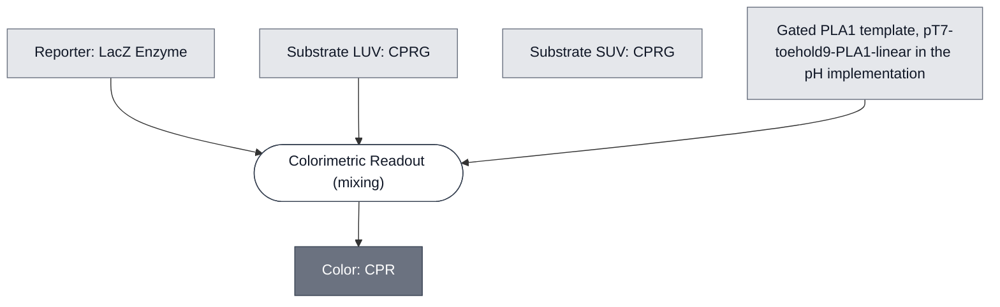
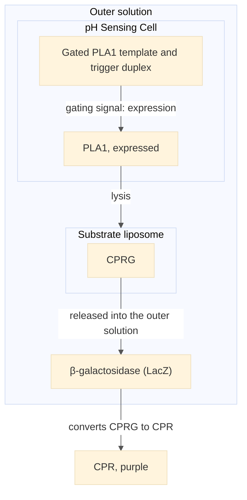

:::{attention} 🚧 Draft
This page is a work in progress and not yet ready for use.
:::

# Overview

Color Change turns a gating signal into a visible color. Phospholipase A1 (PLA1) is expressed only when a signal is present. PLA1 lyses a membrane that holds the chromogenic substrate chlorophenol red-β-D-galactopyranoside (CPRG), and the released CPRG meets β-galactosidase (LacZ), which converts the yellow CPRG into the purple chlorophenol red (CPR). The Module is two operations in order: lysis, then color reporting. Where each component sits, and how many membranes lysis has to cross, depends on the implementation. The documented implementation is the [pH Cascade](../ph-cascade/spec.md), with PLA1 expressed in a [pH Sensing Cell](../ph-sensing-cell/spec.md), CPRG in separate liposomes, and the enzyme in the outer solution.

# Reference Composition

:::::{tab-set}

<!-- gen:composition-diagram -->
::::{tab-item} Module Dependencies

::::
<!-- /gen:composition-diagram -->

::::{tab-item} Containers

Container diagram of the pH implementation: each box is a compartment, and each arrow is an operation that crosses a membrane.

:::{table} Where each component sits in the pH implementation.
:label: comp-color-change-containers

| Component | Compartment | Module |
| --- | --- | --- |
| Gated PLA1 template, `pT7-toehold9-PLA1-linear` | Cytosol of the pH Sensing Cell | [Detector: pH-Sensing](../detector-ph/spec.md), [pH Sensing Cell](../ph-sensing-cell/spec.md) |
| PLA1 | Made in the pH Sensing Cell; acts on membranes | [pH Sensing Cell](../ph-sensing-cell/spec.md) |
| CPRG | Inner solution of a substrate liposome, until lysis; then the outer solution | [Substrate LUV: CPRG](../substrate-cprg-luv/spec.md), [Substrate SUV: CPRG](../substrate-cprg-suv/spec.md) |
| β-galactosidase | Outer solution | [Reporter: LacZ Enzyme](../reporter-lacz-enzyme/spec.md) |
:::

:::{attention}
@Editor: Add one row of this table, and one diagram, for each other implementation when its data are public: the multi-gel study and the LuxR to PLA1 demo.
:::
::::

::::{tab-item} Substrate

:::{table} Where the substrate is held until lysis in the pH implementation.
:label: comp-color-change-substrate

| Substrate | Held in | Module |
| --- | --- | --- |
| CPRG | Inner solution of the LUV | [Substrate LUV: CPRG](../substrate-cprg-luv/spec.md) |
| CPRG | Inner solution of the SUV | [Substrate SUV: CPRG](../substrate-cprg-suv/spec.md) |
:::
::::

::::{tab-item} DNA

:::{table} Gated PLA1 construct of the pH implementation. Other implementations gate PLA1 with a different signal and a different regulatory DNA.
:label: comp-color-change-dna

| Name | Length | Supply | File |
| --- | --- | --- | --- |
| `pT7-toehold9-PLA1-linear` | 1203 bp | Linear DNA template, added to the cytosol at 2 nM | [pT7-toehold9-PLA1-linear.gb](https://github.com/nucleus-eng/DNA/blob/bf3d5aeea79c652b3f7af08f32409dbc7b3431b0/effectors/detector-ph/pT7-toehold9-PLA1-linear.gb) |
:::

::::

:::::

# Expected Behavior

## Cells

In the pH implementation, Color Change is expected to stay yellow when the gating signal is absent (pH 7.6) and to turn purple when it is present (pH 6.3), after β-galactosidase is added at the readout. Data are in the [Colorimetric pH Sensor](../../implementations/colorimetric-ph-sensor/main.md), read by [Colorimetric Readout](../../processes/colorimetric-readout/main.md).

:::{warning} Not yet validated
Gating of PLA1 by a signal other than pH is not reported on this page.
:::

# Requirements

Requires a signal that gates PLA1 expression, built into the DNA of the PLA1 source (e.g. [Detector: pH-Sensing](../detector-ph/spec.md)).

Requires pT7 transcription and translation where PLA1 is expressed (e.g. [Base Cytosol](../base-cytosol/spec.md)).

Requires a control that separates sensing-driven color from CPRG leakage (see [Substrate LUV: CPRG](../substrate-cprg-luv/spec.md)).

# Implementations

- [Colorimetric pH Sensor](../../implementations/colorimetric-ph-sensor/main.md)

# Processes

- [Encapsulation: Freeze-Thaw](../../processes/encapsulate-freeze-thaw/main.md) makes the substrate liposomes.
- [Protocol: Inverted Emulsion](../../processes/assemble-base-cell/protocol-guv.md) makes the cell that expresses PLA1.
- [Embedding: Thermal Setting](../../processes/embed-thermal-setting/main.md) places both in a gel.
- [Colorimetric Readout](../../processes/colorimetric-readout/main.md) adds the enzyme and reads the color.

# Constituent Modules

- [Reporter: LacZ Enzyme](../reporter-lacz-enzyme/spec.md) — converts released CPRG from yellow to purple
- [Substrate LUV: CPRG](../substrate-cprg-luv/spec.md) — holds CPRG until lysis
- [Substrate SUV: CPRG](../substrate-cprg-suv/spec.md) — alternative substrate population, used in place of the LUV

# Credits

Developed by [Sung-Won Hwang](https://orcid.org/0000-0003-1686-7090), [Samuel Chen](https://orcid.org/0000-0001-8501-7175) and [Allen P. Liu](https://orcid.org/0000-0002-0309-7018) (University of Michigan).

:::{attention}
@Editor: Add the Node and Lab to this credit.
:::

# Supported by

[DevNotes](https://devnotes.nucleus.engineering) that support this specification include:

::::{grid} 1 1 1 1
:class: devnote-cards

:::{card} Two Vesicle Colorimetric pH Sensor System
:link: https://devnotes.nucleus.engineering/articles/01a0ea82-2101-7fed-82f9-1d8ef9258009
:footer: Sung-Won Hwang, Samuel Chen, Allen P. Liu · DevStudio 2026

:::

::::
