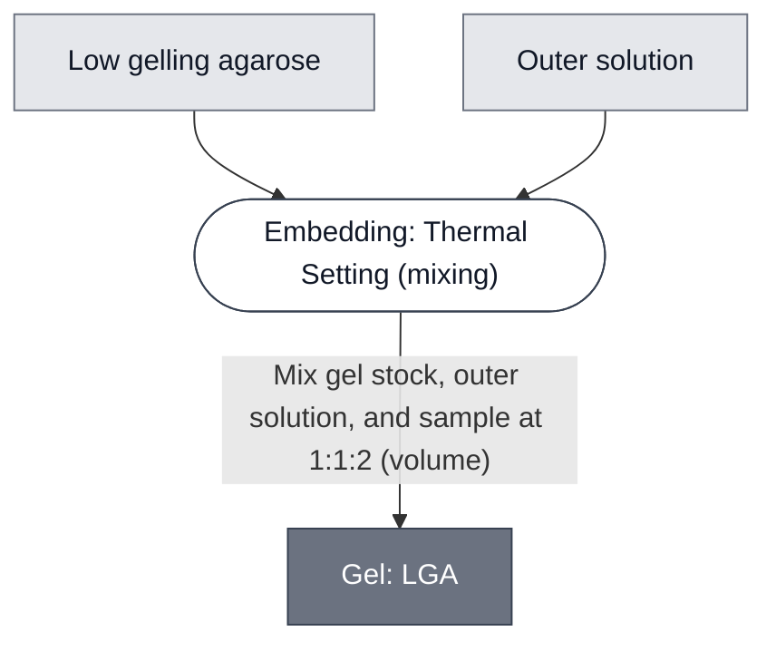

# Overview

LGA (low gelling agarose) is a hydrogel in which synthetic cells can be embedded. LGA sets upon cooling to between 24 °C and 28 °C, so the agarose stock is held at 45 °C until it is mixed with a sample. See [Embedding: Thermal Setting](../../processes/embed-thermal-setting/main.md) for a description of the embedding process.

:::{attention} 🚧 Draft
This page is a work in progress and not yet ready for use.
:::

# Reference Composition

:::::{tab-set}

<!-- gen:composition-diagram -->
::::{tab-item} Module Dependencies

::::
<!-- /gen:composition-diagram -->

::::{tab-item} Composition

:::{table} Composition of LGA.
| Component | Stock concentration | Final concentration |
| --- | --- |  --- |
| Outer solution | - | - |
| Low gelling agarose | 28 mg/mL (2.8 % w/v) | 7 mg/mL (0.7 % w/v) |
:::
::::
:::::

# Expected Behavior

LGA is expected to set when cooled to its gel point between 24 °C and 28 °C. The gel can set at room temperature, so keep the stock warm until ready for use.

# Requirements

Requires an outer solution to dissolve into. For liposomes, use the outer solution used to prepare the liposomes.

Requires that a sample tolerate the temperature at which the gel stock is held (45 °C).

# Processes

[Embedding: Thermal Setting](../../processes/embed-thermal-setting/main.md) prepares the stock and sets the gel.

# Materials

:::{table} Materials of Gel: LGA.
:label: materials-gel-lga

| Name | Category | Product | Manufacturer | Part # | Price | Storage | Link |
| --- | --- | --- | --- | --- | --- | --- | --- |
| Low gelling agarose | Polymer | Low gelling agarose | Sigma-Aldrich | A9414-5G | — | Room temperature | [Sigma-Aldrich A9414](https://www.sigmaaldrich.com/US/en/product/sigma/a9414) |
:::

# Supported by

[DevNotes](https://devnotes.nucleus.engineering) that support this specification include:

::::{grid} 1 1 1 1
:class: devnote-cards

:::{card} Understanding Liposome Behaviour in Hydrogel Matrices
:link: https://devnotes.nucleus.engineering/articles/01a10dfe-c1df-7c2d-ba5a-035280a349f7#hydrogel-preparation
:footer: Ojaswita Pant, Manuel Bibrowski · DevStudio 2026

:::

:::{card} Two Vesicle Colorimetric pH Sensor System
:link: https://devnotes.nucleus.engineering/articles/01a0ea82-2101-7fed-82f9-1d8ef9258009
:footer: Sung-Won Hwang, Samuel Chen, Allen P. Liu · DevStudio 2026

:::

::::
