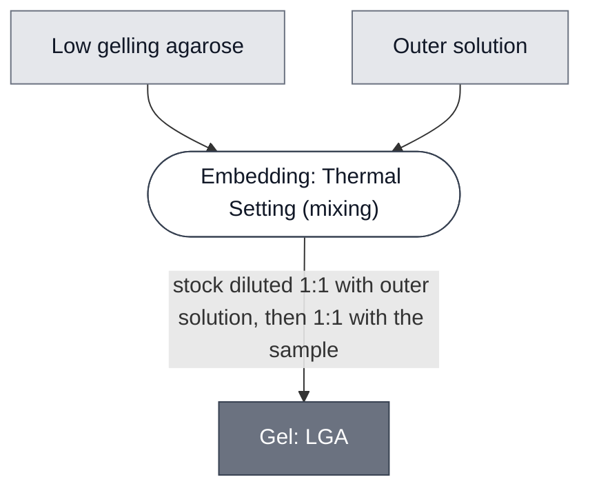

# Overview

Gel: LGA is a physical hydrogel of low gelling agarose (LGA) in an outer solution. The network sets on cooling, at about 24 °C to 28 °C, so the stock is held at 45 °C until it is mixed with a sample. It is set by [Embedding: Thermal Setting](../../processes/embed-thermal-setting/main.md).

:::{attention} 🚧 Draft
This page is a work in progress and not yet ready for use.
:::

# Reference Composition

:::::{tab-set}

<!-- gen:composition-diagram -->
::::{tab-item} Module Dependencies

::::
<!-- /gen:composition-diagram -->

::::{tab-item} Outer Solution

:::{table} Outer solution of Gel: LGA.
| Component | Type |
| --- | --- |
| Outer solution | Solution |
:::

::::

::::{tab-item} Polymer

:::{table} Polymer of Gel: LGA.
| Component | Stock concentration | Final concentration |
| --- | --- | --- |
| Low gelling agarose | 28 mg/mL | 7 mg/mL |
:::

The final concentration is for a stock diluted 1:1 with outer solution and then mixed 1:1 with the sample.

The supplier and part number of the LGA are in the Materials and Equipment section of [Embedding: Thermal Setting](../../processes/embed-thermal-setting/main.md).

:::{attention} Dilution per well is inferred
@Editor: confirm that the stock is diluted 1:1 with outer solution before it is mixed with the sample. The DevNote gives the final LGA concentration as 7 mg/mL with the parenthetical 7.5 µL and 7.5 µL of outer solution, and no step describes the dilution.
:::

::::

:::::

# Expected Behavior

Gel: LGA is expected to set when the mixture cools to its gel point, about 24 °C to 28 °C. It can set at room temperature, so the stock is kept warm until the mixture is dispensed.

# Requirements

Requires an outer solution to dissolve into. For liposomes, use the outer solution used to prepare the liposomes.

Requires that a sample tolerate mixing at 45 °C.

# Processes

[Embedding: Thermal Setting](../../processes/embed-thermal-setting/main.md) prepares the stock and sets the gel.

# Constituent Modules

- Outer solution — the solution the polymer dissolves into
- Low gelling agarose — the polymer

# Credits

Developed by Ojaswita Pant (Northwestern University, DevCells Chicago Node) and Manuel Bibrowski (Imperial College London, DevCells London Node).

:::{attention} Credits need a Lab
@Editor: add each contributor's Lab.
:::
