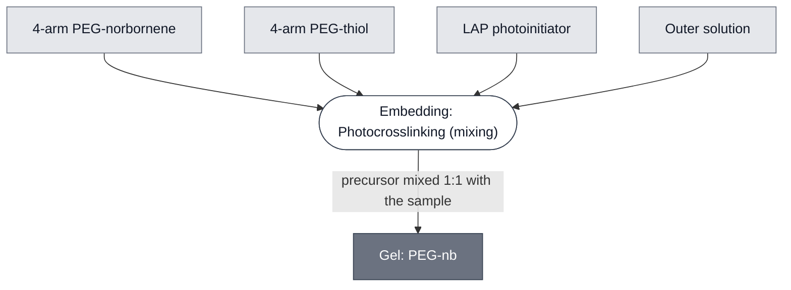

# Overview

Gel: PEG-nb is a poly(ethylene glycol) hydrogel made from 4-arm PEG-norbornene (PEG-nb) and a 4-arm PEG-thiol crosslinker, with the photoinitiator lithium phenyl-2,4,6-trimethylbenzoylphosphinate (LAP). The precursor does not set in response to temperature. The network sets when the precursor is exposed to 405 nm light, so a sample can be loaded and checked before the gel forms. It is set by [Embedding: Photocrosslinking](../../processes/embed-photocrosslinking/main.md).

:::{attention} 🚧 Draft
This page is a work in progress and not yet ready for use.
:::

# Reference Composition

:::::{tab-set}

<!-- gen:composition-diagram -->
::::{tab-item} Module Dependencies

::::
<!-- /gen:composition-diagram -->

::::{tab-item} Precursor Solution

:::{table} Precursor of Gel: PEG-nb.
| Component | Molecular weight (g/mol) | Concentration |
| --- | --- | --- |
| 4-arm PEG-norbornene | 5000 | 80 mM |
| 4-arm PEG-thiol | 2000 | 20 mM |
| LAP | 294.21 | 16.9 mM |
| Outer solution | | Solution |
:::

The precursor is mixed 1:1 with the sample. Final after the 1:1 mix: PEG-nb 40 mM.

::::

:::::

# Expected Behavior

Gel: PEG-nb is expected to stay liquid until it is exposed to 405 nm light, and to set under a 60 s exposure from a projector. It is easy to pipette as a precursor.

Gel: PEG-nb shows higher autofluorescence than [Gel: ULGA](../gel-ulga/spec.md) and [Gel: LGA](../gel-lga/spec.md) in fluorescence microscopy. This lowers the signal-to-background ratio of a green fluorescent reporter in it. The comparison is GFP-channel microscopy of GUVs and LUVs embedded in each gel ([Figure 6](https://devnotes.nucleus.engineering/articles/01a10dfe-c1df-7c2d-ba5a-035280a349f7#hydrogel-preparation)).

:::{attention} Imaging process page is not linked
@Editor: link the imaging Process page, `microscopy-readout` (Layer 1), once it is on `main`.
:::

# Requirements

Requires a light source at 405 nm (e.g. a digital light processing projector).

Requires an outer solution to dissolve into. For liposomes, use the outer solution used to prepare the liposomes.

:::{attention} Osmotic match has no published result
@Editor: cite the result that shows what happens to liposomes embedded in a solvent that does not match their outer solution, once it is published.
:::

# Processes

[Embedding: Photocrosslinking](../../processes/embed-photocrosslinking/main.md) prepares the precursor and sets the gel.

# Materials

:::{table} Materials of Gel: PEG-nb.
:label: materials-gel-peg-nb

| Name | Category | Product | Manufacturer | Part # | Price | Storage | Link |
| --- | --- | --- | --- | --- | --- | --- | --- |
| 4-arm PEG-norbornene | Polymer | 4-arm PEG-norbornene | Creative Pegworks | `PSB-4110` | — | −20 °C, dark | [Creative PEGWorks PSB-4110](https://creativepegworks.com/product/4-arm-peg-norbornene-mw-5k) |
| 4-arm PEG-thiol | Crosslinker | 4-arm PEG-thiol | Creative Pegworks | `PSB-440-5g` | — | −20 °C, dark | [Creative PEGWorks PSB-440](https://creativepegworks.com/group/4-arm-peg-thiol) |
| LAP | Photoinitiator | Lithium phenyl-2,4,6-trimethylbenzoylphosphinate | Sigma-Aldrich | 900889-1G | — | 2 °C to 8 °C, dark | [Sigma-Aldrich 900889](https://www.sigmaaldrich.com/US/en/product/aldrich/900889) |
:::

# Constituent Modules

- 4-arm PEG-norbornene — the polymer
- 4-arm PEG-thiol — the crosslinker
- LAP — the photoinitiator
- Outer solution — the solution the precursor dissolves into

# Credits

Developed by Ojaswita Pant (Northwestern University, DevCells Chicago Node, Truby Lab) and Manuel Bibrowski (Imperial College London, DevCells London Node, Elani Lab).

# Supported by

[DevNotes](https://devnotes.nucleus.engineering) that support this specification include:

::::{grid} 1 1 1 1
:class: devnote-cards

:::{card} Understanding Liposome Behaviour in Hydrogel Matrices
:link: https://devnotes.nucleus.engineering/articles/01a10dfe-c1df-7c2d-ba5a-035280a349f7#hydrogel-preparation
:footer: Ojaswita Pant, Manuel Bibrowski · DevStudio 2026

:::

:::{card} TetO-Regulated PLA1 Sensor in Vesicles: aTc Titration and Spatial Patterning
:link: https://devnotes.nucleus.engineering/articles/01a1304b-1c56-7352-a082-ba84a2684f82
:footer: Mary Kelly, Madison Briggs · DevStudio 2026

:::

::::
