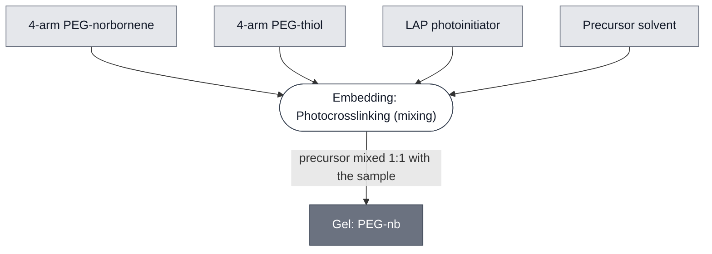

# Overview

Gel: PEG-nb is a poly(ethylene glycol) hydrogel made from 4-arm PEG-norbornene (PEG-nb) and a 4-arm PEG-thiol crosslinker, with the photoinitiator lithium phenyl-2,4,6-trimethylbenzoylphosphinate (LAP). The precursor does not set in response to temperature. The network sets when the precursor is exposed to 405 nm light, so a sample can be loaded and checked before the gel forms. It is set by [Embedding: Photocrosslinking](../../processes/embed-photocrosslinking/main.md).

:::{attention} 🚧 Draft
This page is a work in progress and not yet ready for use.
:::

# Reference Composition

:::::{tab-set}

<!-- gen:composition-diagram -->
::::{tab-item} Module Dependencies

::::
<!-- /gen:composition-diagram -->

::::{tab-item} Precursor Solution

:::{table} Precursor of Gel: PEG-nb.
| Component | Molecular weight (g/mol) | Concentration |
| --- | --- | --- |
| 4-arm PEG-norbornene | 5000 | 80 mM |
| 4-arm PEG-thiol | 2000 | 20 mM |
| LAP | 294.21 | 16.9 mM |
| Solvent | | Solution |
:::

The precursor is mixed 1:1 with the sample.

::::

:::::

# Expected Behavior

Gel: PEG-nb is expected to stay liquid until it is exposed to 405 nm light, and to set under a 60 s exposure from a projector. It is easy to pipette as a precursor.

Gel: PEG-nb shows higher autofluorescence than [Gel: ULGA](../gel-ulga/spec.md) and [Gel: LGA](../gel-lga/spec.md) in fluorescence microscopy, which lowers the signal-to-background ratio of a green fluorescent reporter in it.

:::{attention} Imaging method is not described
@Editor: name the imaging process, channel and settings behind the autofluorescence comparison, and link its Process page, `microscopy-readout` (Layer 1), once it is on `main`.
:::

# Requirements

Requires a light source at 405 nm (e.g. a digital light processing projector).

Requires an outer solution to dissolve into. For liposomes, use the outer solution used to prepare the liposomes.

:::{attention} Osmotic match has no published result
@Editor: cite the result that shows what happens to liposomes embedded in a solvent that does not match their outer solution, once it is published.
:::

# Processes

[Embedding: Photocrosslinking](../../processes/embed-photocrosslinking/main.md) prepares the precursor and sets the gel.

# Constituent Modules

- 4-arm PEG-norbornene — the polymer
- 4-arm PEG-thiol — the crosslinker
- LAP — the photoinitiator
- Precursor solvent — the solution the precursor dissolves into

# Credits

Developed by Ojaswita Pant (Northwestern University, DevCells Chicago Node) and Manuel Bibrowski (Imperial College London, DevCells London Node).

:::{attention} Credits need a Lab
@Editor: add each contributor's Lab.
:::
