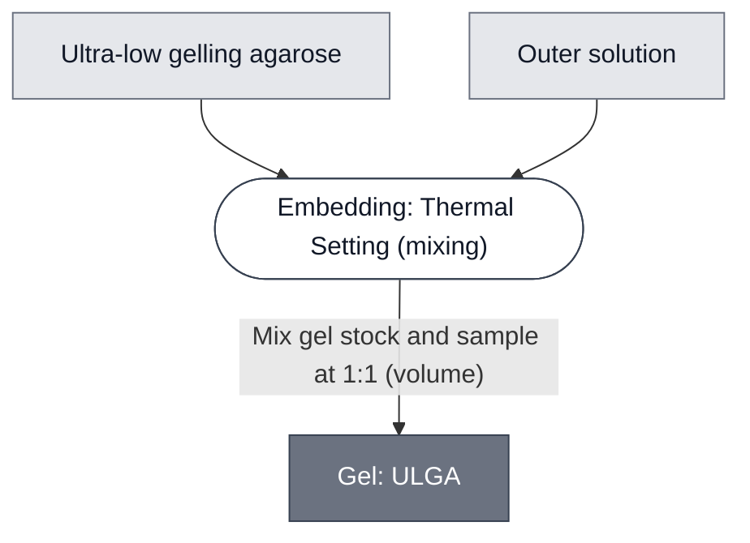

(gel-ulga-overview)=
# Overview

ULGA (ultra-low gelling agarose) is a hydrogel in which synthetic cells can be embedded. ULGA sets upon cooling to between 8 °C and 15 °C. See [Embedding: Thermal Setting](../../processes/embed-thermal-setting/main.md) for a description of the embedding process.

:::{attention} 🚧 Draft
This page is a work in progress and not yet ready for use.
:::

(gel-ulga-reference-composition)=
# Reference Composition

:::::{tab-set}

<!-- gen:composition-diagram -->
::::{tab-item} Module Dependencies

::::
<!-- /gen:composition-diagram -->

::::{tab-item} Composition

:::{table} Composition of ULGA.
| Component |  Stock concentration | Final concentration |
| --- | --- |  --- |
| Outer solution | - | - |
| Ultra-low gelling agarose | 10 mg/mL (1.0 % w/v) | 5 mg/mL (0.5 % w/v) |
:::
::::
:::::

(gel-ulga-expected-behavior)=
# Expected Behavior

ULGA is expected to set when cooled to its gel point between 8 °C and 15 °C. The gel stock is held at 55 °C until use.

(gel-ulga-requirements)=
# Requirements

Requires an outer solution to dissolve into. For liposomes, use the outer solution used to prepare the liposomes.

Requires that a sample tolerate the temperature at which the gel stock is held (55 °C).

(gel-ulga-processes)=
# Processes

[Embedding: Thermal Setting](../../processes/embed-thermal-setting/main.md) prepares the stock and sets the gel.

(gel-ulga-materials)=
# Materials

:::{table} Materials of Gel: ULGA.
:label: materials-gel-ulga

| Name | Category | Product | Manufacturer | Part # | Price | Storage | Link |
| --- | --- | --- | --- | --- | --- | --- | --- |
| Ultra-low gelling agarose | Polymer | Ultra-low gelling agarose | Sigma-Aldrich | A5030 | — | Room temperature | [Sigma-Aldrich A5030](https://www.sigmaaldrich.com/US/en/product/sial/a5030) |
:::

# Supported by

[DevNotes](https://devnotes.nucleus.engineering) that support this specification include:

::::{grid} 1 1 1 1
:class: devnote-cards

:::{card} Bacterial Sensing in Hydrogel Embedded Synthetic Cells using LuxR Dependent Transcriptional Regulation
:link: https://devnotes.nucleus.engineering/articles/01a1121a-7513-7ec7-8378-0326c6b3630b#guv-embedding-in-gels-for-synthetic-ahl-experiment
:footer: Julia Purrinos de Oliveira, Niall McIntyre, Manuel Bibrowski, Charlie Newell, Jonah McDonald · DevStudio 2026

:::

:::{card} Understanding Liposome Behaviour in Hydrogel Matrices
:link: https://devnotes.nucleus.engineering/articles/01a10dfe-c1df-7c2d-ba5a-035280a349f7#hydrogel-preparation
:footer: Ojaswita Pant, Manuel Bibrowski · DevStudio 2026

:::

::::
