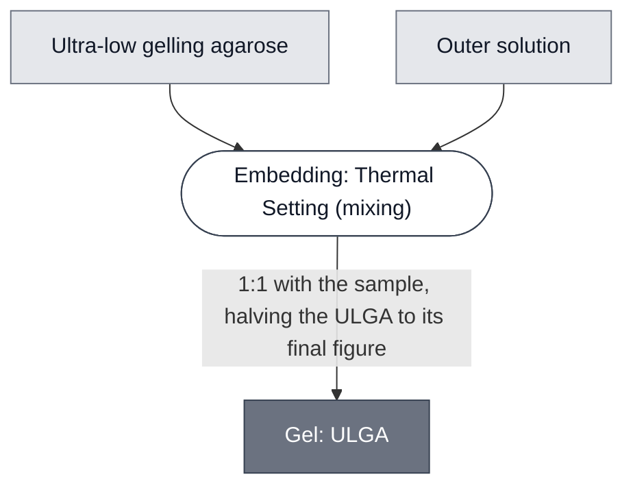

# Overview

Gel: ULGA is a physical hydrogel of ultra-low gelling agarose (ULGA) in an outer solution. The network sets on cooling, at about 8 °C to 15 °C. It is set by [Embedding: Thermal Setting](../../processes/embed-thermal-setting/main.md).

:::{attention} 🚧 Draft
This page is a work in progress and not yet ready for use.
:::

# Reference Composition

:::::{tab-set}

<!-- gen:composition-diagram -->
::::{tab-item} Module Dependencies

::::
<!-- /gen:composition-diagram -->

::::{tab-item} Outer Solution

:::{table} Outer solution of Gel: ULGA.
| Component | Type |
| --- | --- |
| Outer solution | Solution |
:::

::::

::::{tab-item} Polymer

:::{table} Polymer of Gel: ULGA.
| Component | Stock concentration | Final concentration |
| --- | --- | --- |
| Ultra-low gelling agarose | 10 mg/mL | 5 mg/mL |
:::

The final concentration is for a stock mixed 1:1 with the sample.

:::{attention} ULGA supplier is not stated
@Editor: give the supplier and catalog number of the ULGA.
:::

::::

:::::

# Expected Behavior

Gel: ULGA is expected to set when the mixture cools to its gel point, about 8 °C to 15 °C. It is easy to pipette as a stock.

:::{attention} Setting is not described
@Editor: state the temperature at which the ULGA stock, held at 55 °C, is mixed with a sample, and how the mixture is cooled to its gel point.
:::

# Requirements

Requires an outer solution to dissolve into. For liposomes, use the outer solution used to prepare the liposomes.

Requires that a sample tolerate the temperature at which it is mixed with the stock.

# Processes

[Embedding: Thermal Setting](../../processes/embed-thermal-setting/main.md) prepares the stock and sets the gel.

# Constituent Modules

- Outer solution — the solution the polymer dissolves into
- Ultra-low gelling agarose — the polymer

# Credits

Developed by Ojaswita Pant (Northwestern University, DevCells Chicago Node) and Manuel Bibrowski (Imperial College London, DevCells London Node).

:::{attention} Credits need a Lab
@Editor: add each contributor's Lab.
:::
