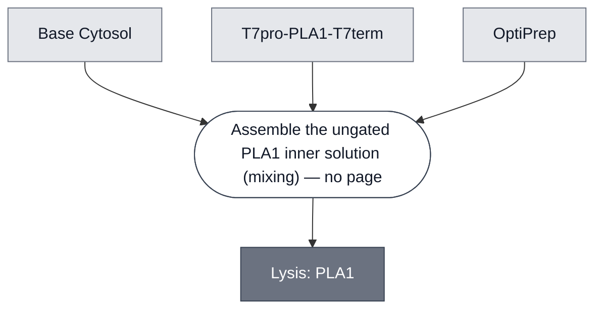

(lysis-pla1-overview)=
# Overview

The PLA1 Lysis Module uses phospholipase A1 (PLA1) to encode lysis genetically. Once expressed, PLA1 degrades the phospholipid membrane and lyses the cell that made it and its neighbors. Lysis releases chemical payloads from neighboring liposomes (e.g. [Substrate SUV: CPRG](../substrate-cprg-suv/spec.md)) into an external solution (e.g. one that contains [Reporter: LacZ](../reporter-lacz/spec.md), which triggers a [colorimetric signal](../../processes/colorimetric-readout/main.md)). PLA1 can sit downstream of a sensing circuit that controls when it is expressed (e.g. [Detector: tetR-aTc](../detector-tetr-atc/spec.md)) and upstream of a reporter that requires lysis (e.g. [Reporter: LacZ](../reporter-lacz/spec.md)).

:::{attention} 🚧 Draft
This page is a work in progress and not yet ready for use.
:::

:::{attention} PLA1 is characterized only through a color readout
One configuration removes the sensing circuit: constitutive expression in Base Cytosol, described under Expected Behavior. It supplies the only DNA dose and timing figures attributable to PLA1 alone. Every other result on this page comes from a cascade, where the sensing circuit and PLA1 cannot be separated.

No result isolates PLA1 from the CPRG/LacZ readout. Every lysis result is scored by the color it releases. None comes from a direct measure of membrane rupture or of enzyme activity. No efficiency figure exists for PLA1 in any configuration.
:::

(lysis-pla1-reference-composition)=
# Reference Composition

:::::{tab-set}

<!-- gen:composition-diagram -->
::::{tab-item} Module Dependencies

::::
<!-- /gen:composition-diagram -->

::::{tab-item} DNA

:::{table}
| Name | Length (bp) | File | Supply route |
| --- | --- | --- | --- |
| `T7pro-PLA1-T7term` | not yet determined | None | pT7. Used in the Chicago theophylline cascade and the ungated London run. Also written `T7-PLA1-T7term` in the linear-template batch prepared alongside the [Detector: 3OC6-HSL (EsaR)](../detector-esar/spec.md) constructs. |
| `LuxR-PLA1-linear` | 2237 | [LuxR-PLA1-linear.gb](https://github.com/nucleus-eng/DNA/blob/devcells/devstudio-constructs/effectors/detector-3oc6-hsl/LuxR-PLA1-linear.gb) | Constitutive `BBa_J23101`→`luxR` with `pLux`-driven PLA1 on one molecule. Used in the London 3OC6-HSL cascade. Also referred to as `P70lux-PLA1-term`. |
:::

:::{attention} `T7pro-PLA1-T7term` is not in `nucleus-eng/DNA`
@Editor: `T7pro-PLA1-T7term` has no confirmed sequence file in [nucleus-eng/DNA](https://github.com/nucleus-eng/DNA). b.next to add the file there. Then confirm that it matches the construct by `LOCUS` length, not by name, and add its length and file to the table above.
:::

The enzyme has two coding sequences. Every construct that carries PLA1 carries 963 bp of coding sequence, and all of them encode the same protein. They do not all use the same DNA. Chicago's two gated constructs, `pT7-tetO-PLA1` and `pT7-toehold9-PLA1`, are identical across the whole coding sequence. London's `LuxR-PLA1` agrees with them at 77.6 % of nucleotides and 100 % of residues, so it is a separate codon optimization of the same enzyme.

The two sequences are interchangeable at the protein level and distinct at the DNA level. Codon usage is tuned to a host, and the two Nodes use different cytosols. Substituting one sequence for the other changes the construct, although the enzyme stays the same. Length cannot tell them apart.

::::

::::{tab-item} Cytosol

PLA1 is expressed from one of the constructs above rather than added as a reagent, so it has no working concentration of its own.

:::{table} PLA1 DNA dose, by configuration.
:label: comp-pla1-cytosol

| Configuration | Construct | Working concentration |
| --- | --- | --- |
| Constitutive, ungated | `T7pro-PLA1-T7term` | 14 ng/µL, in Base Cytosol at 1× in a 20 µL reaction with 5 % OptiPrep |
| aTc-gated | `TetO-PLA1` | 1 nM (also tested at 0.5 nM) |
| 3OC6-HSL-gated | `LuxR-PLA1` | 15 ng/µL |
| pH-gated | Toehold-switch-gated PLA1 template | 2 nM |
| Theophylline-gated | `T7pro-PLA1-T7term` | Not documented |
:::

The cytosol is whichever the host configuration uses: [Base Cytosol](../base-cytosol/spec.md) for the aTc-gated, pH-gated and theophylline-gated cascades and for the ungated run, and [S30 Lysate](../s30-lysate/spec.md) for the London 3OC6-HSL cascade.

::::

<!-- composition-tabs: no-table (PLA1 acts on any phospholipid membrane in reach, so a single lipid table would be wrong) -->
::::{tab-item} Membrane

PLA1 lyses a membrane, so a membrane is part of every configuration that uses it. No lipid composition is specific to this Module. The membranes used with it are [Membrane: POPC/Chol (9:1)](../membrane-popc-chol-9-1/spec.md) and [Membrane: POPC](../membrane-popc/spec.md).

Every configuration needs a self-lysis target. The two-liposome cascades also need the membrane of a neighboring [Substrate SUV: CPRG](../substrate-cprg-suv/spec.md).

::::

:::::

(lysis-pla1-expected-behavior)=
# Expected Behavior

(lysis-pla1-cells)=
## Cells

The PLA1 Lysis Module is expected to lyse the synthetic cell that expresses PLA1 and the synthetic cells near it. One documented configuration reports on PLA1 rather than on a cascade, because nothing gates it.

In the London constitutive configuration, `T7pro-PLA1-T7term` at 14 ng/µL in [Base Cytosol](../base-cytosol/spec.md) liposomes drives the two-liposome CPRG/LacZ handoff with no sensing circuit. Color appears from about 3 h at 37 °C and is easily discernible by 16 h, against a minus-DNA control in the same run. The result was reproduced across multiple days, so a visible result is expected on that timescale at this dose. The recorded outer solution is 1200 mM glucose and 0.1 mM CaCl₂ with 15 mg/mL ultra-low-gelling agarose (ULGA), so this is the gel format (see [Embedding: Thermal Setting](../../processes/embed-thermal-setting/main.md)).

Every other configuration on record puts a sensing circuit in front of PLA1, so PLA1 and its gate cannot be told apart. A weak result there can come from either. Those results belong to the cascades that produced them, and each cascade's own page carries them.

:::{attention} Premature lysis has two independent causes
Gramicidin A causes premature lysis. Used as a proton channel for the pH cascade's GFP-expression result, it was left out of the colorimetric demonstration. It ruptured a portion of the CPRG-loaded liposomes and produced nonspecific color. Its absence can reduce pH-sensing efficiency, but proton diffusion into the more permeable liposomes was enough to drive PLA1 expression and start the lysis cascade.

Acidic conditions alone rupture some CPRG-loaded liposomes, independent of PLA1. This confounds attributing a color change to the sensing pathway.

Account for both routes, and do not assume that a liposome stays intact until the intended trigger.
:::

(lysis-pla1-requirements)=
# Requirements

Requires a phospholipid membrane to lyse (e.g. [Membrane: POPC](../membrane-popc/spec.md), [Membrane: POPC/Chol (9:1)](../membrane-popc-chol-9-1/spec.md)).

PLA1 imposes lysis on any phospholipid membrane in reach. It cannot distinguish the membrane that expressed it from a neighbor's, or one population from another that shares its composition. Take a sensing cell and a substrate carrier that share one membrane formulation. PLA1 reaching the carrier is the intended path. PLA1 reaching another sensing cell is not. Nothing in the chemistry separates them. A composition that needs them separated states that requirement itself.

PLA1 requires a low noise floor in whatever drives it, and any color change module built on PLA1 inherits that requirement. It fails that requirement today for three separate reasons:

1. Leaky promoter. In [SensorCell[3OC6-HSL ⟶ PLA1]](../ahsl-sensing-cell/spec.md), PLA1 is expressed without 3OC6-HSL. It colors nearly as much as the induced state, so the dynamic range is gone.
2. Membrane that does not outlive the reaction. In [Cell: Base Cytosol, POPC/Chol (9:1)](../cell-base-cytosol-popc-chol/spec.md) GUVs, PLA1 takes 10 to 12 h to lyse them, and the GUVs leak on their own over that window. The negative control also colors: slightly purple against slightly more purple when induced.
3. Leaky gate. The pH path's own template is leaky. The function test for `pT7-toehold9-PLA1` is recorded as leaky, so the toehold gate passes some transcription with no trigger present.

The detector is the component that currently fails this requirement. The LacZ/CPRG reaction does not fail it. No numeric threshold is defined for how low the noise floor has to be.

:::{attention} Sources for the noise-floor observations
@Editor: The London Node to cite the DevNote or data for the background PLA1 expression without 3OC6-HSL.

@Editor: The Chicago Node to cite the GUV leak, and the statement that the detector, not the LacZ/CPRG reaction, fails the requirement. State whether that statement covers the gel-driven release described below, which is not a detector failure.

@Editor: Cite a source for the leaky function test on `pT7-toehold9-PLA1`.

The negative-control color above comes from a gel attempt in which CPRG-loaded LUVs with β-galactosidase and no PLA1-expressing cells developed color on their own. That color is a release of substrate, not a detector failure. @Editor: Cite that gel attempt.
:::

Requires an upstream sensing circuit (e.g. [Detector: 3OC6-HSL (LuxR)](../detector-3oc6-hsl/spec.md), [Detector: tetR-aTc](../detector-tetr-atc/spec.md)) only where lysis needs to be conditional. Expressed constitutively, PLA1 lyses on its own schedule.

Requires pT7 transcription and translation, when using `T7pro-PLA1-T7term` (e.g. [Base Cytosol](../base-cytosol/spec.md)).

Requires σ70 transcription and translation, when using `LuxR-PLA1` (e.g. [S30 Lysate](../s30-lysate/spec.md)).

Do not add Gramicidin A to a colorimetric cascade. See [Expected Behavior](#lysis-pla1-expected-behavior) for why.

(lysis-pla1-implementations)=
# Implementations

- [aTc Demo](../../implementations/devstudio-atc-demo/main.md): the lysis step, expressed from `TetO-PLA1`.
- [CRAIC Demo](../../implementations/devstudio-craic-demo/main.md): the lysis step, expressed once repression lifts.
- [pH Demo](../../implementations/devstudio-ph-demo/main.md): the lysis step, expressed from the `pT7-toehold9-PLA1` template.

(lysis-pla1-processes)=
# Processes

- [Degrade Exterior LacZ](../../processes/degrade-exterior-lacz/main.md): applies only where LacZ is encapsulated. Proteinase K cannot distinguish one LacZ from another, so in a configuration that puts LacZ in the outer solution, it digests the reporter.
- [Colorimetric Readout](../../processes/colorimetric-readout/main.md): the CPRG conversion that produces the visible signal.
- [Embedding: Ionic Crosslinking](../../processes/embed-ionic-crosslinking/main.md): ionic crosslinking of alginate.
- [Embedding: Thermal Setting](../../processes/embed-thermal-setting/main.md): thermal gelation of ultra-low-gelling agarose.

(lysis-pla1-constituent-modules)=
# Constituent Modules

- [Base Cytosol](../base-cytosol/spec.md): transcription and translation, for the ungated configuration.

(lysis-pla1-credits)=
# Credits

Developed by Jonah McDonald and Charlie Newell (London Node) and Mary Kelly (Chicago Node, Kamat Lab).

:::{attention} Credits need confirmation
@Editor: Confirm each credit with the Node before this page merges to `main`.
:::
