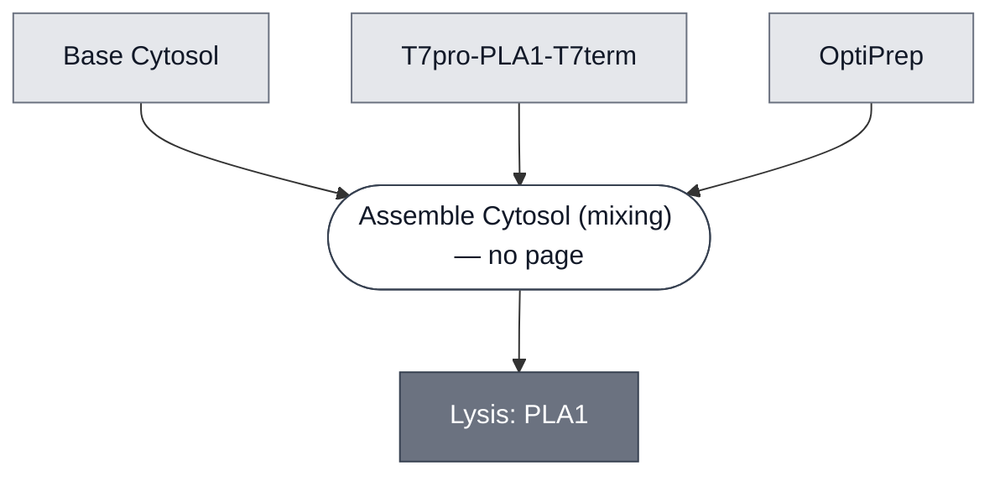

(lysis-pla1-overview)=
# Overview

The PLA1 Lysis Module uses phospholipase A1 (PLA1) to genetically encode lysis. Once expressed, PLA1 degrades phospholipid membranes and lyses cells, including its neighbors. Lysis releases chemical payloads from neighboring liposomes (e.g. [Substrate SUV: CPRG](../substrate-cprg-suv/spec.md)) into an external solution. An example is a solution that contains Reporter: LacZ, which triggers a [colorimetric signal](../../processes/colorimetric-readout/main.md). PLA1 can sit downstream of a sensing circuit that controls when it is expressed (e.g. [Detector: tetR-aTc](../detector-tetr-atc/spec.md)).

:::{attention} 🚧 Draft
This page is a work in progress and not yet ready for use.
:::

:::{attention} PLA1 is characterized only through a color readout
One configuration removes the sensing circuit: constitutive expression in Base Cytosol, described under Expected Behavior. It supplies the only DNA dose and timing figures attributable to PLA1 alone.

No result isolates PLA1 from the CPRG/LacZ readout. No result comes from a direct measure of membrane rupture or of enzyme activity. No efficiency figure exists for PLA1 in any configuration.
:::

(lysis-pla1-reference-composition)=
# Reference Composition

:::::{tab-set}

<!-- gen:composition-diagram -->
::::{tab-item} Module Dependencies

::::
<!-- /gen:composition-diagram -->

::::{tab-item} DNA

:::{table} DNA constructs that express PLA1, with their supply route.
:label: comp-pla1-dna

| Name                       | Length (bp)        | File                                                                                                                          | Promoter                            | Format                   |
| -------------------------- | ------------------ | ----------------------------------------------------------------------------------------------------------------------------- | ----------------------------------- | ------------------------ |
| `T7pro-PLA1-T7term`        | Not yet determined | Not yet in `nucleus-eng/DNA`                                                                                                  | pT7 (constitutive)                  | Unknown.                 |
| `pT7-tetO-PLA1-linear`     | 1202               | [pT7-tetO-PLA1-linear.gb](https://github.com/nucleus-eng/DNA/blob/main/effectors/detector-tetr-atc/pT7-tetO-PLA1-linear.gb)   | pT7 (aTc induction)                 | Linear template          |
| `pOpen-T7-tetO-PLA1`       | 3140               | [pOpen-T7-tetO-PLA1.gb](https://github.com/nucleus-eng/DNA/blob/main/effectors/detector-tetr-atc/pOpen-T7-tetO-PLA1.gb)       | pT7 (aTc induction)                 | Circular plasmid (pOpen) |
| `LuxR-PLA1-linear`         | 2237               | [LuxR-PLA1-linear.gb](https://github.com/nucleus-eng/DNA/blob/main/effectors/detector-3oc6-hsl/LuxR-PLA1-linear.gb)           | σ70 (3OC6-HSL induced;`BBa_J23101`) | Linear template          |
| `pOpen-LuxR-PLA1`          | 4175               | [pOpen-LuxR-PLA1.gb](https://github.com/nucleus-eng/DNA/blob/main/effectors/detector-3oc6-hsl/pOpen-LuxR-PLA1.gb)             | σ70 (3OC6-HSL induced;`BBa_J23101`) | Circular plasmid (pOpen) |
| `pT7-toehold9-PLA1-linear` | 1203               | [pT7-toehold9-PLA1-linear.gb](https://github.com/nucleus-eng/DNA/blob/main/effectors/detector-ph/pT7-toehold9-PLA1-linear.gb) | pT7 (pH induction)                  | Linear template          |
:::

:::{attention} `T7pro-PLA1-T7term` is not in `nucleus-eng/DNA`
@Editor: `T7pro-PLA1-T7term` has no confirmed sequence file in [nucleus-eng/DNA](https://github.com/nucleus-eng/DNA). 
:::

The two sequences are interchangeable at the protein level and distinct at the DNA level (codon usage). Substituting one sequence for the other changes the construct, but not the resulting enzyme or behavior.

::::

::::{tab-item} Cytosol

PLA1 is expressed from one of the DNA constructs listed rather than added as a purified protein.

:::{table} PLA1 DNA dose, by configuration.
:label: comp-pla1-cytosol

| Configuration | Construct | Working concentration |
| --- | --- | --- |
| Constitutive | `T7pro-PLA1-T7term` | 14 ng/µL |
| aTc induced| `TetO-PLA1` | 1 nM |
| 3OC6-HSL induced | `LuxR-PLA1` | 15 ng/µL |
| pH induced | Toehold-switch-gated PLA1 template | 2 nM |
:::

The cytosol depends on the host configuration. The aTc-gated, pH-gated and theophylline-gated cascades and the ungated run use [Base Cytosol](../base-cytosol/spec.md). 3OC6-HSL cascade uses S30 Lysate.

::::

<!-- composition-tabs -->
::::{tab-item} Membrane

PLA1 lyses a phospholipid membrane, but is not specific to a particular lipid composition. The membranes validated with this module are Membrane: POPC/Chol (9:1) and Membrane: POPC.

::::

:::::

(lysis-pla1-expected-behavior)=
# Expected Behavior

(lysis-pla1-cells)=
## Cells

The PLA1 Lysis Module is expected to lyse synthetic cells expressesing PLA1 as well as any nearby neighbors.

(lysis-pla1-requirements)=
# Requirements

Requires a phospholipid membrane to lyse (e.g. Membrane: POPC, Membrane: POPC/Chol (9:1)).

PLA1 imposes lysis on any phospholipid membrane in reach. It cannot distinguish the membrane that expressed it from a neighbor's. 

Requires an upstream sensing circuit (e.g. Detector: 3OC6-HSL (LuxR), [Detector: tetR-aTc](../detector-tetr-atc/spec.md)) only where lysis needs to be conditional. Expressed constitutively, PLA1 lyses vesicles as it is expressed.

Requires pT7 transcription and translation, when using `T7pro-PLA1-T7term` (e.g. [Base Cytosol](../base-cytosol/spec.md)).

Requires σ70 transcription and translation, when using `LuxR-PLA1` (e.g. S30 Lysate).

Do not add Gramicidin A to a colorimetric cascade. See [Expected Behavior](#lysis-pla1-expected-behavior) for why.

(lysis-pla1-implementations)=
# Implementations

- pH Demo: the lysis step, expressed from the `pT7-toehold9-PLA1` template.

# Supported by

[DevNotes](https://devnotes.nucleus.engineering) that support this specification include:

::::{grid} 1 1 1 1
:class: devnote-cards

:::{card} Triggered Lysis of beta-Galactosidase-Loaded GUVs by Cell-Free Expressed Phospholipase A1
:link: https://devnotes.nucleus.engineering/articles/01a12d42-ca2e-70e7-b78b-66fcf11c400a
:footer: Mary Kelly, Ojaswita Pant · DevStudio 2026

:::

:::{card} Co-Encapsulated Cell-Free PLA1 Expression in beta-Galactosidase GUVs
:link: https://devnotes.nucleus.engineering/articles/01a12e24-46dc-761d-b020-f1f77cce78ba
:footer: Mary Kelly, Madison Briggs · DevStudio 2026

:::

:::{card} TetO-Regulated PLA1 Sensor in Vesicles: aTc Titration and Spatial Patterning
:link: https://devnotes.nucleus.engineering/articles/01a1304b-1c56-7352-a082-ba84a2684f82
:footer: Mary Kelly, Madison Briggs · DevStudio 2026

:::

:::{card} Double Vesicle Lysis System Leveraging deGFP CFPE
:link: https://devnotes.nucleus.engineering/articles/01a16026-42c1-71ad-842a-463d52fae7d8
:footer: Mary Kelly, Madison Briggs · DevStudio 2026

:::

:::{card} Two Vesicle Colorimetric pH Sensor System
:link: https://devnotes.nucleus.engineering/articles/01a0ea82-2101-7fed-82f9-1d8ef9258009
:footer: Sung-Won Hwang, Samuel Chen, Allen P. Liu · DevStudio 2026

:::

:::{card} Implementing of a bulk color change module into bacterial quorum sensing
:link: https://devnotes.nucleus.engineering/articles/01a12e6c-b511-7d30-aa95-002d386f751e
:footer: Manuel Bibrowski, Charlie Newell, Jonah McDonald, Niall McIntyre, Julia Purrinos de Oliveira · DevStudio 2026

:::

::::
