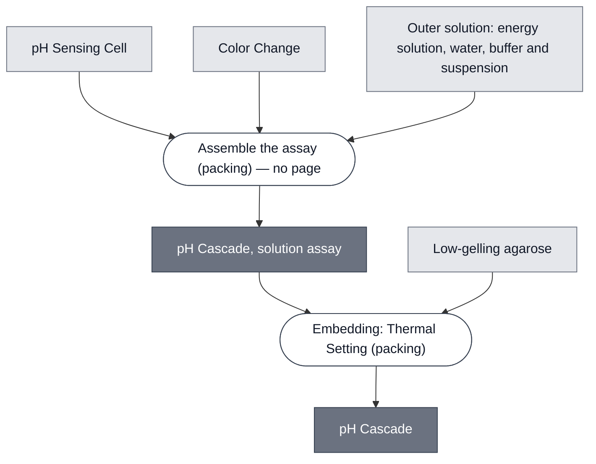

:::{attention} 🚧 Draft
This page is a work in progress and not yet ready for use.
:::

# Overview

The pH Cascade turns an acidic outer solution into a visible color change with two liposome populations. Acidic pH makes the [pH Sensing Cells](../ph-sensing-cell/spec.md) express phospholipase A1 (PLA1). PLA1 lyses the neighboring substrate liposomes ([Substrate LUV: CPRG](../substrate-cprg-luv/spec.md) or [Substrate SUV: CPRG](../substrate-cprg-suv/spec.md)), which release chlorophenol red-β-D-galactopyranoside (CPRG) into the outer solution. [β-galactosidase](../reporter-lacz-enzyme/spec.md) (LacZ) in the outer solution converts the yellow CPRG into the purple chlorophenol red (CPR). The cascade senses acidic pH, about 6.0 to 6.5.

:::{figure} schematic.png
:align: center
:width: 75%

Schematic representation of the pH Cascade. A pH Sensing Cell with its DNA sits next to a substrate liposome (Substrate LUV: CPRG or Substrate SUV: CPRG), with β-galactosidase in the outer solution. The cell expresses PLA1, and PLA1 lyses the substrate liposome. The released CPRG is converted by β-galactosidase into CPR.
:::

# Reference Composition

:::::{tab-set}

<!-- gen:composition-diagram -->
::::{tab-item} Module Dependencies

::::
<!-- /gen:composition-diagram -->

::::{tab-item} DNA

:::{table} DNA of the pH Cascade. All three constructs are in the pH Sensing Cell.
:label: comp-ph-cascade-dna

| Name | Length | Supply | File |
| --- | --- | --- | --- |
| `pT7-toehold9-PLA1-linear` | 1203 bp | Linear DNA template, added to the cell cytosol at 2 nM | [pT7-toehold9-PLA1-linear.gb](https://github.com/nucleus-eng/DNA/blob/bf3d5aeea79c652b3f7af08f32409dbc7b3431b0/effectors/detector-ph/pT7-toehold9-PLA1-linear.gb) |
| `pH-responsive-ssDNA-2` | 49 nt | Single-stranded oligo, annealed with the trigger strand | [pH-responsive-ssDNA-2.gb](https://github.com/nucleus-eng/DNA/blob/bf3d5aeea79c652b3f7af08f32409dbc7b3431b0/detectors/detector-ph/pH-responsive-ssDNA-2.gb) |
| `trigger-ssDNA-3` | 36 nt | Single-stranded oligo, annealed with the pH-responsive strand | [trigger-ssDNA-3.gb](https://github.com/nucleus-eng/DNA/blob/bf3d5aeea79c652b3f7af08f32409dbc7b3431b0/detectors/detector-ph/trigger-ssDNA-3.gb) |
:::

β-galactosidase is added as purified enzyme and has no DNA construct.

::::

::::{tab-item} pH Sensing Cell

The [pH Sensing Cell](../ph-sensing-cell/spec.md) is 50 mL/L of a 60 µL assay.

:::{table} Inner solution of the pH Sensing Cell.
:label: comp-ph-cascade-cell-cytosol

| Component | Input concentration | Final concentration | Volume for one preparation (µL) |
| --- | --- | --- | --- |
| SMix | 3.33× | 1× | 6 |
| PMix | 15 mg/mL | 1.80 mg/mL | 2.4 |
| Ribosomes | 10 µM | 1.8 µM | 3.6 |
| tRNA | 35 mg/mL | 3.5 mg/mL | 2 |
| `pT7-toehold9-PLA1-linear` DNA template | 80 nM | 2 nM | 0.5 |
| pH-responsive : trigger ssDNA duplex (3:1), annealed | 25 µM, as the trigger strand | 4.625 µM | 3.7 |
| Optiprep | 1000 mL/L | 45 mL/L | 0.9 |
| RNase inhibitor | 40 000 U/mL | 1000 U/mL | 0.5 |
| Cy5 (sulfo-Cyanine5 carboxylic acid) | 100 µM | 2 µM | 0.4 |
| Total volume (µL) | | | 20 |
:::

:::{table} Membrane of the pH Sensing Cell. Volumes are for the lipid stocks that make 2.5 µmol of total lipid.
:label: comp-ph-cascade-cell-membrane

| Component | Target (mmol/mol) | Molecular Weight (g/mol) | Stock concentration (mg/mL) | Volume to add (µL) |
| --- | --- | --- | --- | --- |
| POPC | 899.1 | 760.076 | 25 | 68.34 |
| Cholesterol | 99.9 | 386.654 | 50 | 1.93 |
| Liss-Rhod PE | 1 | 1301.71 | 1 | 3.25 |
:::
::::

::::{tab-item} Substrate LUV: CPRG

The [Substrate LUV: CPRG](../substrate-cprg-luv/spec.md) is 35 mL/L of a 60 µL solution assay and 50 mL/L of a 60 µL gel assay.

:::{table} Inner solution of Substrate LUV: CPRG.
:label: comp-ph-cascade-luv-inner-solution

| Component | Stock concentration | Final concentration | Volume for one preparation (µL) |
| --- | --- | --- | --- |
| CPRG | 30 mg/mL | 14.25 mg/mL | 237.5 |
| Optiprep | 1000 mL/L | 100 mL/L | 50 |
| Tris1M-HEPES1.15M buffer stock | 2520 mOsm | 1071 mOsm | 212.5 |
| Total volume (µL) | | | 500 |
:::

:::{table} Membrane of Substrate LUV: CPRG. Volumes are for the lipid stocks that make 2 µmol of total lipid.
:label: comp-ph-cascade-luv-membrane

| Component | Target (mmol/mol) | Molecular Weight (g/mol) | Stock concentration (mg/mL) | Volume to add (µL) |
| --- | --- | --- | --- | --- |
| POPC | 899.1 | 760.076 | 25 | 54.67 |
| Cholesterol | 99.9 | 386.654 | 50 | 1.55 |
| Liss-Rhod PE | 1 | 1301.71 | 1 | 2.60 |
:::
::::

::::{tab-item} Substrate SUV: CPRG

The [Substrate SUV: CPRG](../substrate-cprg-suv/spec.md) is used in place of the LUV. Its membrane is the same as the LUV's.

:::{table} Inner solution of Substrate SUV: CPRG.
:label: comp-ph-cascade-suv-inner-solution

| Component | Final concentration | Volume for one preparation (µL) |
| --- | --- | --- |
| CPRG | not documented | not documented |
| Other components | not documented | not documented |
| Total volume (µL) | | 1000 |
:::

:::{attention}
@Developer: Give the composition of the SUV inner solution.
:::
::::

::::{tab-item} Outer Solution

:::{table} Outer solution of the pH Cascade, as a fraction of the assay volume. The pH 7.6 arm takes the Tris1M-HEPES1.15M buffer stock, and the pH 6.3 arm takes the buffer mix for pH 6.3.
:label: comp-ph-cascade-outer-solution

| Component | Fraction (mL/L) |
| --- | --- |
| Energy solution (2×) | 500 |
| Ultrapure water | 260 |
| Tris1M-HEPES1.15M buffer stock, or buffer mix for pH 6.3 | 120 |
| pH Sensing Cells and substrate liposomes in suspension buffer | 120 |
| Total | 1000 |
:::

In a solution assay the 120 mL/L is 3 µL of cells (50 mL/L), 2.1 µL of substrate liposomes (35 mL/L) and 2.1 µL of suspension buffer (35 mL/L) in 60 µL. In a gel assay it is 3 µL of cells (50 mL/L), 3 µL of substrate liposomes (50 mL/L) and 1.2 µL of suspension buffer (20 mL/L).

:::{table} Buffer mix for pH 6.3. It replaces the Tris1M-HEPES1.15M buffer stock in the acidic arm.
:label: comp-ph-cascade-buffer-mix

| Component | Fraction (mL/L) | Volume (µL) |
| --- | --- | --- |
| Tris1M-HEPES1.15M buffer stock | 388.9 | 466.67 |
| 2 M HEPES stock | 480.2 | 576.19 |
| 37 % HCl | 66.7 | 80 |
| Ultrapure water | 64.3 | 77.14 |
| Total volume (µL) | 1000 | 1200 |
:::

:::{table} Energy solution (2×), a sub-mix of ten components made up to 4000 µL, adapted from the PURE formulation ([Shimizu et al., 2001](https://doi.org/10.1038/90802)) and the OnePot PURE method ([Lavickova and Maerkl, 2019](https://doi.org/10.1021/acssynbio.8b00427)). The final concentration is the concentration in the assay.
:label: comp-ph-cascade-energy-solution

| Component | Stock concentration | Volume (µL) | Final concentration |
| --- | --- | --- | --- |
| Spermidine | 1 M | 12 | 1.5 mM |
| Creatine phosphate | 1 M | 200 | 25 mM |
| Magnesium acetate tetrahydrate | 1 M | 144 | 18 mM |
| L-Glutamic acid potassium salt monohydrate | 2 M | 1120 | 280 mM |
| Folinic acid calcium salt hydrate | 332 mM | 9.2 | 0.3818 mM |
| ATP | 100 mM | 300 | 3.75 mM |
| GTP | 100 mM | 200 | 2.5 mM |
| CTP | 100 mM | 100 | 1.25 mM |
| UTP | 100 mM | 100 | 1.25 mM |
| Amino acid mix (RTS Amino Acid Sampler) | 6 mM | 400 | 0.3 mM |
| Ultrapure water | | 1414.8 | |
| Total volume (µL) | | 4000 | |
:::

:::{table} Enzyme added for the readout. β-galactosidase is added as a 3× solution in the [basic buffer](../reporter-lacz-enzyme/spec.md) at pH 9.9, and dilutes the assay volume from 60 µL to 90 µL.
:label: comp-ph-cascade-enzyme

| Component | Stock concentration | 3× concentration | Final concentration |
| --- | --- | --- | --- |
| β-galactosidase | 1000 U/mL | 3.6 U/mL | 1.2 U/mL |
:::

:::{attention}
@Editor: The gel configuration adds low-gelling agarose to the outer solution (see [Embedding: Thermal Setting](../../processes/embed-thermal-setting/main.md)). No Module page for the gel is part of this set, so the gel has no tab here.
:::
::::

:::::

# Expected Behavior

## Cells

The pH Cascade is expected to turn from yellow to purple in solution in the pH 6.3 arm, and to stay yellow in the pH 7.6 arm, when β-galactosidase is added at the readout in the basic buffer (pH 9.9), which raises the pH so that the enzyme can act. The color was visible by eye after 5.5 h at 37 °C with 1.2 U/mL β-galactosidase. A run with 2 U/mL was read after 2 h. Gramicidin A is not part of the composition: it caused a portion of the CPRG-loaded liposomes to rupture prematurely, which gave nonspecific color, and PLA1 expression driven by proton diffusion into a subset of liposomes with relatively permeable membranes appeared to be sufficient to start lysis. Data are in the [Colorimetric pH Sensor](../../implementations/colorimetric-ph-sensor/main.md), read by [Colorimetric Readout](../../processes/colorimetric-readout/main.md).

## Gels

The pH Cascade with Substrate SUV: CPRG in 3.5 mg/mL low-gelling agarose is expected to show the same color pattern as in solution. In 7 mg/mL low-gelling agarose with 2 U/mL β-galactosidase, color developed without PLA1 (see [Substrate LUV: CPRG](../substrate-cprg-luv/spec.md)). Data are in the [Colorimetric pH Sensor](../../implementations/colorimetric-ph-sensor/main.md), read by [Colorimetric Readout](../../processes/colorimetric-readout/main.md).

# Requirements

Requires a control that separates sensing-driven color from CPRG leakage. A control without pH Sensing Cells shows leakage that happens without PLA1 (see [Substrate LUV: CPRG](../substrate-cprg-luv/spec.md)).

Requires that gramicidin A is not added (see Expected Behavior).

:::{attention}
@Developer: State whether the outer solution osmolarity of 1170 mOsm/kg to 1180 mOsm/kg for the liposome suspension is a requirement, and give its tolerance.
:::

# Implementations

- [Colorimetric pH Sensor](../../implementations/colorimetric-ph-sensor/main.md)

# Processes

- [Anneal pH Trigger Duplex](../../processes/anneal-ph-trigger-duplex/main.md) makes the duplex of the pH Sensing Cell.
- [Encapsulation: Freeze-Thaw](../../processes/encapsulate-freeze-thaw/main.md) makes the substrate liposomes, as LUVs or SUVs.
- [Protocol: Inverted Emulsion](../../processes/assemble-base-cell/protocol-guv.md) makes the pH Sensing Cells.
- [Embedding: Thermal Setting](../../processes/embed-thermal-setting/main.md) places both populations in a gel.
- [Colorimetric Readout](../../processes/colorimetric-readout/main.md) develops and reads the color.

# Materials

:::{table}
:label: bom-ph-cascade
:align: center

| Name | Category | Product | Manufacturer | Part # | Price | Storage | Link |
| ---- | -------- | ------- | ------------ | ------ | ----- | ------- | ---- |
| Spermidine | Chemical | Spermidine | Millipore Sigma | S2626 | | | |
| Creatine phosphate | Chemical | Creatine phosphate | Millipore Sigma | 10621714001 | | | |
| Magnesium acetate tetrahydrate | Chemical | Magnesium acetate tetrahydrate | Millipore Sigma | M5661 | | | |
| Potassium glutamate | Chemical | L-Glutamic acid potassium salt monohydrate | Millipore Sigma | G1501 | | | |
| Folinic acid | Chemical | Folinic acid calcium salt hydrate | Millipore Sigma | F7878 | | | |
| ATP | Chemical | ATP | Millipore Sigma | A6419-1G or 5G | | | |
| GTP | Chemical | GTP | Millipore Sigma | G8877-250MG | | | |
| CTP | Chemical | CTP | Millipore Sigma | C1506-250MG | | | |
| UTP | Chemical | UTP | Millipore Sigma | U6750-1G or 500MG | | | |
| Amino acid mix | Reagent | RTS Amino Acid Sampler | Biotechrabbit | BR1401801 | | | |
| HEPES | Salts | HEPES, Crystalline Powder, ≥99.5% (titration), Poly bottle | Sigma-Aldrich | H3375-500G | $431 | 4 °C to 30 °C | [link](https://www.sigmaaldrich.com/US/en/product/sigma/h3375) |
| Hydrochloric acid | Chemical | Hydrochloric acid, ACS reagent, 37% | Millipore Sigma | 320331-500ML | $106.00 | 4 °C to 30 °C | [link](https://www.sigmaaldrich.com/US/en/product/sigald/320331) |
:::

:::{attention}
@Developer: Give the price, storage and link of the energy solution components, and the manufacturer and part number of Tris base and of β-galactosidase.
:::

# Constituent Modules

- [pH Sensing Cell](../ph-sensing-cell/spec.md) — population that expresses PLA1 at acidic pH
- [Color Change](../color-change/spec.md) — lyses the substrate liposomes when PLA1 is present and reports the released CPRG as a color, through [Substrate LUV: CPRG](../substrate-cprg-luv/spec.md) or [Substrate SUV: CPRG](../substrate-cprg-suv/spec.md) and [Reporter: LacZ Enzyme](../reporter-lacz-enzyme/spec.md)

# Credits

Developed by [Sung-Won Hwang](https://orcid.org/0000-0003-1686-7090), [Samuel Chen](https://orcid.org/0000-0001-8501-7175) and [Allen P. Liu](https://orcid.org/0000-0002-0309-7018) (University of Michigan).

:::{attention}
@Editor: Add the Node and Lab to this credit.
:::

# Supported by

[DevNotes](https://devnotes.nucleus.engineering) that support this specification include:

::::{grid} 1 1 1 1
:class: devnote-cards

:::{card} Two Vesicle Colorimetric pH Sensor System
:link: https://devnotes.nucleus.engineering/articles/01a0ea82-2101-7fed-82f9-1d8ef9258009
:footer: Sung-Won Hwang, Samuel Chen, Allen P. Liu · DevStudio 2026

:::

::::
