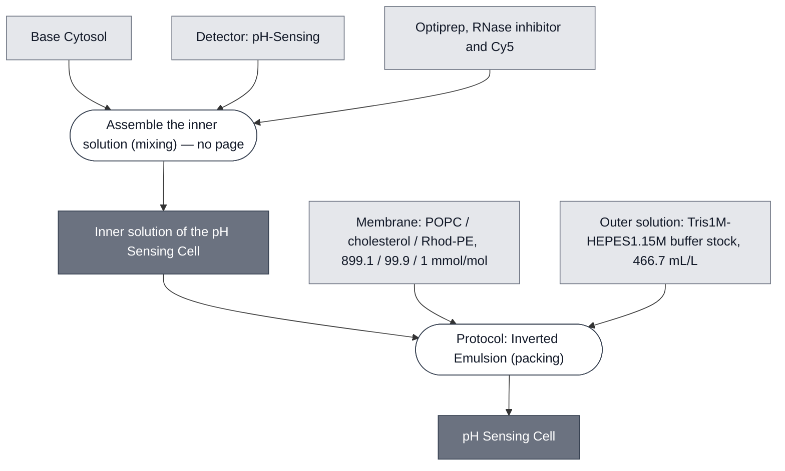

:::{attention} 🚧 Draft
This page is a work in progress and not yet ready for use.
:::

# Overview

The pH Sensing Cell is a synthetic cell that expresses phospholipase A1 (PLA1) when its outer solution is acidic, at about pH 6.0 to 6.5. The [pH-Sensing Detector](../detector-ph/spec.md) gates the expression: acidification releases a trigger strand, and the free trigger strand opens the toehold switch in front of the PLA1 gene. PLA1 disrupts phospholipid membranes: the membrane of the cell that expresses it, and the membranes of neighboring liposomes, which then release their contents. Cy5 in the inner solution marks the cell. A cell with an intact membrane is bright in the Cy5 channel.

The cell is [Base Cytosol](../base-cytosol/spec.md) with the pH-Sensing Detector added, encapsulated in a POPC/cholesterol membrane by [Protocol: Inverted Emulsion](../../processes/assemble-base-cell/protocol-guv.md). The membrane has its own ratio of lipids, given in the Membrane tab, and it differs from the ratio of the [Base Membrane: POPC/Chol](../membrane-popc-chol/spec.md).

# Reference Composition

:::::{tab-set}

<!-- gen:composition-diagram -->
::::{tab-item} Module Dependencies

::::
<!-- /gen:composition-diagram -->

::::{tab-item} DNA

:::{table} DNA of the pH Sensing Cell.
:label: comp-ph-sensing-cell-dna

| Name | Length | Supply | File |
| --- | --- | --- | --- |
| `pT7-toehold9-PLA1-linear` | 1203 bp | Linear DNA template, added to the cytosol at 2 nM | [pT7-toehold9-PLA1-linear.gb](https://github.com/nucleus-eng/DNA/blob/bf3d5aeea79c652b3f7af08f32409dbc7b3431b0/effectors/detector-ph/pT7-toehold9-PLA1-linear.gb) |
| `pH-responsive-ssDNA-2` | 49 nt | Single-stranded oligo, annealed with the trigger strand | [pH-responsive-ssDNA-2.gb](https://github.com/nucleus-eng/DNA/blob/bf3d5aeea79c652b3f7af08f32409dbc7b3431b0/detectors/detector-ph/pH-responsive-ssDNA-2.gb) |
| `trigger-ssDNA-3` | 36 nt | Single-stranded oligo, annealed with the pH-responsive strand | [trigger-ssDNA-3.gb](https://github.com/nucleus-eng/DNA/blob/bf3d5aeea79c652b3f7af08f32409dbc7b3431b0/detectors/detector-ph/trigger-ssDNA-3.gb) |
:::

::::

::::{tab-item} Cytosol

The inner solution is [Base Cytosol](/docs/modules/base-cytosol/spec.md) at reaction concentration, with the PLA1 template, the annealed duplex, Optiprep, RNase inhibitor and Cy5 added.

:::{table} Inner solution of the pH Sensing Cell.
:label: comp-ph-sensing-cell-cytosol

| Component | Input concentration | Final concentration | Volume for one preparation (µL) |
| --- | --- | --- | --- |
| SMix | 3.33× | 1× | 6 |
| PMix | 15 mg/mL | 1.80 mg/mL | 2.4 |
| Ribosomes | 10 µM | 1.8 µM | 3.6 |
| tRNA | 35 mg/mL | 3.5 mg/mL | 2 |
| `pT7-toehold9-PLA1-linear` DNA template | 80 nM | 2 nM | 0.5 |
| pH-responsive : trigger ssDNA duplex (3:1), annealed | 25 µM, as the trigger strand | 4.625 µM | 3.7 |
| Optiprep | 1000 mL/L | 45 mL/L | 0.9 |
| RNase inhibitor | 40 000 U/mL | 1000 U/mL | 0.5 |
| Cy5 (sulfo-Cyanine5 carboxylic acid) | 100 µM | 2 µM | 0.4 |
| Total volume (µL) | | | 20 |
:::

The duplex is annealed in IDT duplex buffer by [Anneal pH Trigger Duplex](../../processes/anneal-ph-trigger-duplex/main.md).

:::{attention}
@Developer: 3.7 µL of the 25 µM duplex in 20 µL gives 4.625 µM of the trigger strand, and the design concentration is 4.8 µM, which needs 3.84 µL. Is 3.7 µL a rounding?
:::
::::

::::{tab-item} Membrane

:::{table} Membrane of the pH Sensing Cell. Volumes are for the lipid stocks that make 2.5 µmol of total lipid.
:label: comp-ph-sensing-cell-membrane

| Component | Target (mmol/mol) | Molecular Weight (g/mol) | Stock concentration (mg/mL) | Volume to add (µL) |
| --- | --- | --- | --- | --- |
| POPC | 899.1 | 760.076 | 25 | 68.34 |
| Cholesterol | 99.9 | 386.654 | 50 | 1.93 |
| Liss-Rhod PE | 1 | 1301.71 | 1 | 3.25 |
:::
::::

::::{tab-item} Outer Solution

:::{table} Suspension buffer, the outer solution in which the pH Sensing Cell is prepared. Its pH is 8, and its osmolarity is 1170 mOsm/kg to 1180 mOsm/kg.
:label: comp-ph-sensing-cell-outer-solution

| Component | Concentration |
| --- | --- |
| Tris1M-HEPES1.15M buffer stock | 466.7 mL/L |
:::

The Tris1M-HEPES1.15M buffer stock is 1 M Tris and 1.15 M HEPES at pH 8, about 2520 mOsm/kg, measured.

:::{attention}
@Developer: Give the diluent of the 466.7 mL/L.
:::
::::

:::::

# Expected Behavior

## Cells

The pH Sensing Cell is expected to keep its Cy5 at pH 7.6 and to lose it at pH 6.3. In solution after 13 h at 37 °C, cells at pH 7.6 kept Cy5, and cells at pH 6.3 lost it, which is consistent with PLA1 expression disrupting the membrane. Data are in the [Colorimetric pH Sensor](../../implementations/colorimetric-ph-sensor/main.md), read by fluorescence microscopy in the Rhodamine and Alexa Fluor 647 channels.

:::{attention}
@Editor: No Process page documents the fluorescence readout.

@Developer: Name the microscope, and give the objective, exposure, gain and laser power of the fluorescence readout. Give the control that shows the loss of Cy5 at pH 6.3 comes from PLA1 expression and not from acid alone, and say what the Rhodamine channel shows in well D5, which holds cells and no liposomes: intact vesicles that lost Cy5, or no vesicles.
:::

# Requirements

Requires pT7 transcription and translation (e.g. [Base Cytosol](../base-cytosol/spec.md)), supplied here by the Base Cytosol in the cell.

# Implementations

- [Colorimetric pH Sensor](../../implementations/colorimetric-ph-sensor/main.md)

# Processes

- [Anneal pH Trigger Duplex](../../processes/anneal-ph-trigger-duplex/main.md) makes the duplex of the pH-responsive strand and the trigger strand.
- [Protocol: Inverted Emulsion](../../processes/assemble-base-cell/protocol-guv.md) makes the cells, from 5 mL of lipid-in-oil at 0.5 mM total lipid.
- [Embedding: Thermal Setting](../../processes/embed-thermal-setting/main.md) places the cells in a gel.

# Materials

:::{table}
:label: bom-ph-sensing-cell
:align: center

| Name | Category | Product | Manufacturer | Part # | Price | Storage | Link |
| ---- | -------- | ------- | ------------ | ------ | ----- | ------- | ---- |
| RNase Inhibitor, Murine | Reagent | RNase Inhibitor, Murine | NEB | M0314S | $87.00 | -25 °C to -15 °C | [link](https://www.neb.com/en-us/products/m0314-rnase-inhibitor-murine) |
| Cy5 | Reagent | Sulfo-Cyanine5 carboxylic acid | Lumiprobe | 13390 | $99.00 | -20 °C | [link](https://www.lumiprobe.com/p/sulfo-cy5-carboxylic-acid) |
| HEPES | Salts | HEPES, Crystalline Powder, ≥99.5% (titration), Poly bottle | Sigma-Aldrich | H3375-500G | $431 | 4 °C to 30 °C | [link](https://www.sigmaaldrich.com/US/en/product/sigma/h3375) |
| IDT duplex buffer | Reagent | Nuclease Free Duplex Buffer (10 x 2 mL) | IDT | 11-01-03-01 | $17.00 | -20 °C | [link](https://www.idtdna.com/site/order/stock/index/nfd) |
| Optiprep | Reagent | OptiPrep™ | STEMCELL Technologies | 07820 | $289.00 | RT | [link](https://www.stemcell.com/products/optipreptm.html) |
| POPC | Lipid | 16:0-18:1 PC 25 mg/mL | Avanti Lipids | A80557 | $435.00 | -20 °C | [link](https://www.avantiresearch.com/en-gb/products/product/850457-160-181-pc-popc) |
| Cholesterol | Lipid | Cholesterol (plant) | Avanti Research | A80100 | $261.00 | -20 °C | [link](https://www.avantiresearch.com/en-gb/products/product/700100-cholesterol-plant) |
| Liss-Rhod PE | Lipid | 18:0 Liss Rhod PE 1 mg/mL | Avanti Lipids | A81179 | $273.47 | -20 °C | [link](https://www.avantiresearch.com/en-gb/products/product/810179-180-liss-rhod-pe) |
| Mineral oil, light | Chemical | Mineral oil, BioReagent, for molecular biology, light oil | Millipore Sigma | M5904-500ML | $78.70 | RT | [link](https://www.sigmaaldrich.com/US/en/product/sigma/m5904) |
:::

:::{attention}
@Developer: Give the manufacturer and part number of Tris base.
:::

# Constituent Modules

- [Base Cytosol](../base-cytosol/spec.md) — inner solution, encapsulated at reaction concentration
- [Detector: pH-Sensing](../detector-ph/spec.md) — turns acidic pH into PLA1 expression

# Credits

Developed by [Sung-Won Hwang](https://orcid.org/0000-0003-1686-7090), [Samuel Chen](https://orcid.org/0000-0001-8501-7175) and [Allen P. Liu](https://orcid.org/0000-0002-0309-7018) (University of Michigan).

:::{attention}
@Editor: Add the Node and Lab to this credit.
:::
