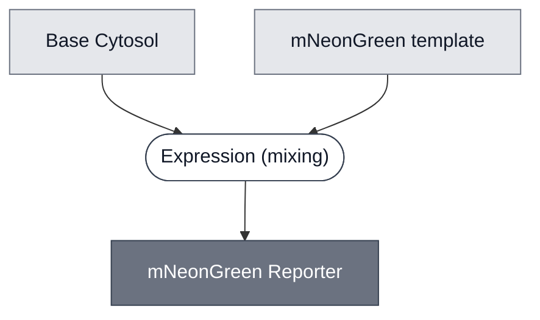

(reporter-mneongreen-overview)=
# Overview

<!-- gen:position -->
**Position.** Refines [Reporter](../reporter/spec.md) and [Fluorophore](../fluorophore/spec.md). Refined by nothing on this branch.
<!-- /gen:position -->

The mNeonGreen Reporter Module produces mNeonGreen, a monomeric green fluorescent protein derived from the lancelet *Branchiostoma lanceolatum*. The protein is the signal, so no substrate is added and the reaction is read directly on a green fluorescence channel.

mNeonGreen excites at 506 nm and emits at 517 nm, with an extinction coefficient of 116 000 M⁻¹ cm⁻¹ and a quantum yield of 0.80. It matures in about 10 min, has a fluorescence lifetime of 3.1 ns, and has a pKa of 5.7. Reference values come from [FPbase: mNeonGreen](https://www.fpbase.org/protein/mneongreen/). [Shaner et al., 2013](https://doi.org/10.1038/nmeth.2413) first reported the protein.

:::{attention} 🚧 Draft
This page is a work in progress and not yet ready for use. The Module runs in both Base Cytosol and S30 Lysate. No working concentration for its template is on record in either. Every reading on this page comes from Base Cytosol.
:::

(reporter-mneongreen-reference-composition)=
# Reference Composition

:::::{tab-set}

<!-- gen:composition-diagram -->
::::{tab-item} Module Dependencies

::::
<!-- /gen:composition-diagram -->

::::{tab-item} DNA

:::{table} Templates carrying the mNeonGreen coding sequence. A length is given only where a sequence exists to read it from.
:label: comp-reporter-mneongreen-constructs

| Construct | Role |
| --- | --- |
| `T7-mNG-T7term` | This Module's own template: the coding sequence with nothing in front of it. It is the unrepressed reference that gated readings are scaled against. No sequence exists for it. |
| `T7-[EsaO]2-mNG-T7term` | 1118 bp. The same coding sequence behind two tandem `EsaO` operator sites. Belongs to [Detector: 3OC6-HSL (EsaR)](../detector-esar/spec.md). |
| `T7-[EsaO]-mNG-T7term` | 1098 bp. The same coding sequence behind one `EsaO` site. |
:::

The coding sequence is mNeonGreen as published, with nothing added to it. It runs 711 bp, which is 236 residues and a stop codon. Those residues match the reference sequence character for character. The two operator-bearing templates carry the sequence base for base, so they differ from each other only in the operator region.

:::{attention} The sequence files are not in `nucleus-eng/DNA`
No file for any template above is in [nucleus-eng/DNA](https://github.com/nucleus-eng/DNA), and the two lengths were read from sequences held elsewhere. `T7-mNG-T7term` has no sequence at all. Supply it first, because every gated reading is scaled against it.

@Editor: London Node to add the files to `nucleus-eng/DNA` and compare each length with its `LOCUS` line.
:::

::::

::::{tab-item} Cytosol

:::{table} The reporter reaction as assembled in Base Cytosol, with no repressor and no operator in it.
:label: comp-reporter-mneongreen-cytosol

| Component | Stock concentration | Final concentration |
| --- | --- | --- |
| [Base Cytosol](../base-cytosol/spec.md) | — | 1× |
| `T7-mNG-T7term` template | Not recorded | Not recorded |
| RNase inhibitor | 40 U/µL | 1 U/µL |
:::

This is the Base Cytosol build, and it is the only one recorded. The Module also runs in [S30 Lysate](../s30-lysate/spec.md), and no composition exists for that reaction.

@Editor: London Node to give the S30 Lysate form its own column here.

The template dose is the gap on this page. The one build on record gives the template as a volume with no concentration behind it. The same coding sequence behind an `EsaO` operator ran across 0.1 to 9 nM. Those doses were chosen to move a repressor-to-template ratio, so none of them is this Module's working concentration.

@Editor: London Node to state the dose for the plain reporter.

::::

:::::

(reporter-mneongreen-expected-behavior)=
# Expected Behavior

The mNeonGreen Reporter Module is expected to give green fluorescence that rises over the course of a reaction, with no substrate added and no second molecule required.

(reporter-mneongreen-cytosols)=
## Cytosols

The Module runs in both [Base Cytosol](../base-cytosol/spec.md) and [S30 Lysate](../s30-lysate/spec.md). What is on record for the two is not the same, so they are stated apart.

In Base Cytosol, fluorescence was read on a Synergy 2 plate reader as a 6 h kinetic at 37 °C with a reading every 5 min. The readings were made against a fluorescein ladder at 0, 0.5, 1 and 2 µM. In those runs this Module was the unrepressed reference, and the gated arms were measured against its signal. No yield, time to half-maximum or template dose is recorded for it, so how bright the reaction gets and how fast it gets there is not known.

In S30 Lysate, the Module expresses and fluoresces as well. No trace, yield, template dose or reader setting is recorded, so every figure and setting above belongs to Base Cytosol alone.

@Editor: London Node to supply one S30 Lysate run, so the two cytosols can be compared on this page.

:::{attention} mNeonGreen sits at the blue edge of the standard green channel
Every reading on record was taken on the standard green channel: 485/20 excitation, 528/20 emission, 510 nm top mirror. mNeonGreen's own maxima are 506 nm and 517 nm. These sit bluer than the center of that channel, so the protein is collected off its peak. The traces are usable, and comparisons between arms hold because every arm was read the same way. A filter set matched to 506/517 would collect more of the signal. An absolute brightness figure for this Module is best taken through such a set.

@Editor: London Node to confirm whether a matched set is available, and re-read one reaction through it.
:::

No plot of this Module alone exists. Every reading on record is the unrepressed arm of a gated titration, where this Module is the reference, not the subject.

(reporter-mneongreen-cells)=
## Cells

:::{warning} Not yet validated
This Module has not been demonstrated in a synthetic cell. Every reading on record is bulk cytosol.
:::

(reporter-mneongreen-requirements)=
# Requirements

Requires pT7 transcription and translation (e.g. [Base Cytosol](../base-cytosol/spec.md), [S30 Lysate](../s30-lysate/spec.md)).

Requires a reader that can excite near 506 nm and collect near 517 nm (e.g. a standard green channel, which collects the protein at the blue edge of its range).

mNeonGreen is sensitive to acid. Its reported pKa is 5.7, so fluorescence falls as a compartment acidifies. No run on this page tests this, and the figure comes from the reference entry.

(reporter-mneongreen-processes)=
# Processes

- [Expression](../../processes/express/main.md): makes the protein from the template, in the compartment that reads it.

No Process page documents the fluorescence readout. The readout used a Synergy 2 plate reader on the standard green channel (485/20 excitation, 528/20 emission) at 37 °C.

@Editor: write the readout up as a Process page, or say which Module it belongs with.

(reporter-mneongreen-constituent-modules)=
# Constituent Modules

- [Base Cytosol](../base-cytosol/spec.md): transcription and translation, at 1×, in the one build on record.
- mNeonGreen template: DNA encoding the reporting protein.

(reporter-mneongreen-credits)=
# Credits

:::{attention} Credits need attributing
@Editor: Add a one-sentence credit for this Module and confirm it with the Node before this page merges to `main`.
:::
